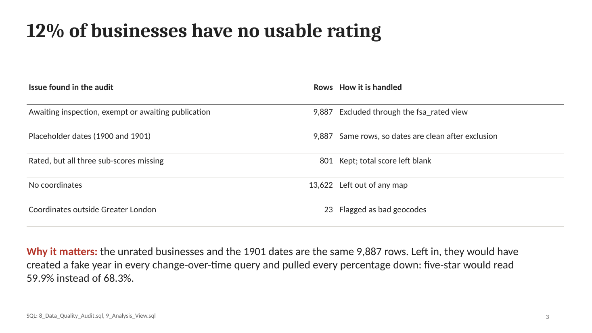
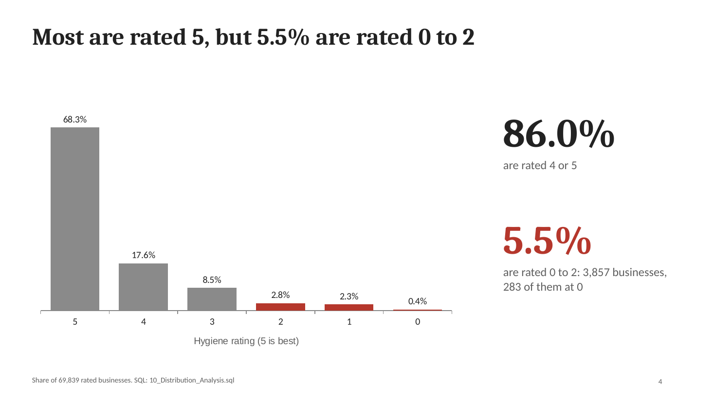
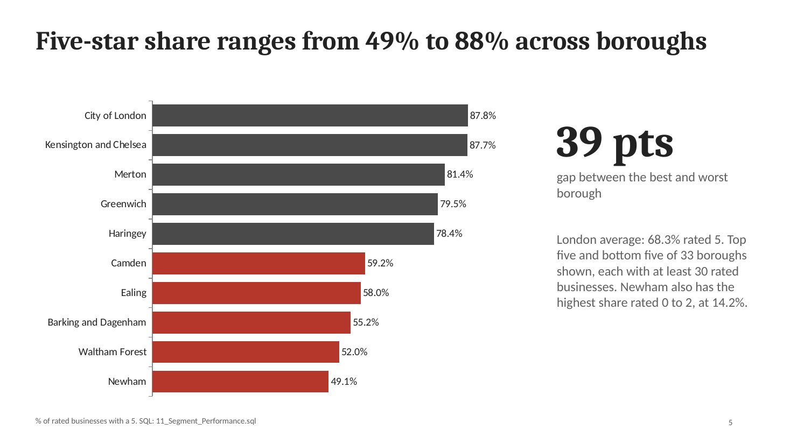
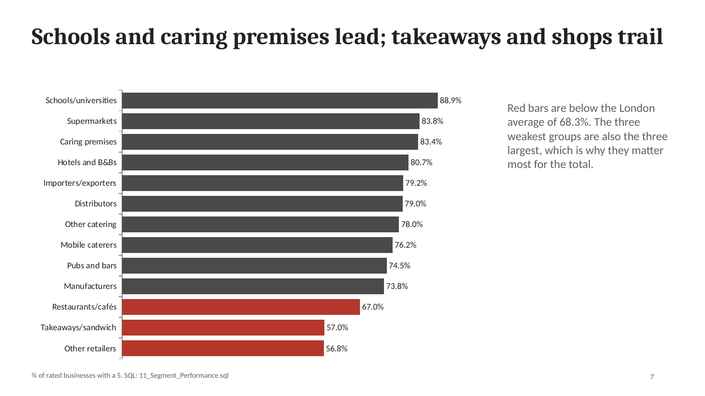
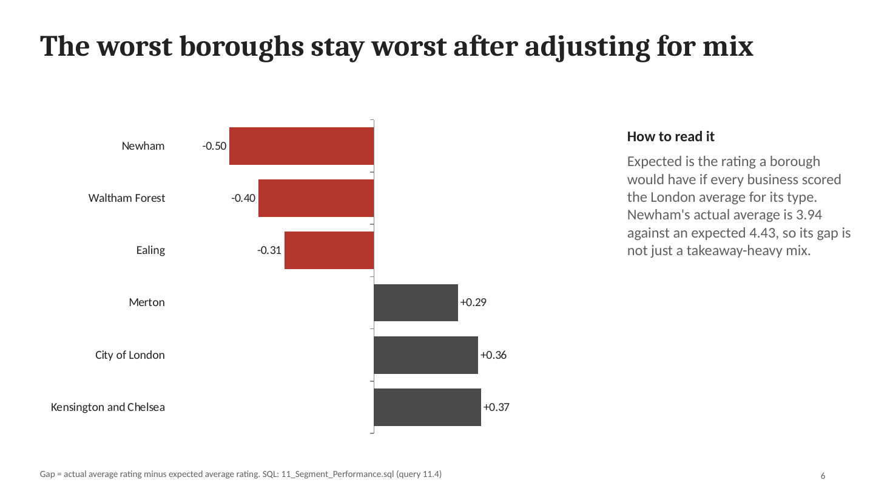
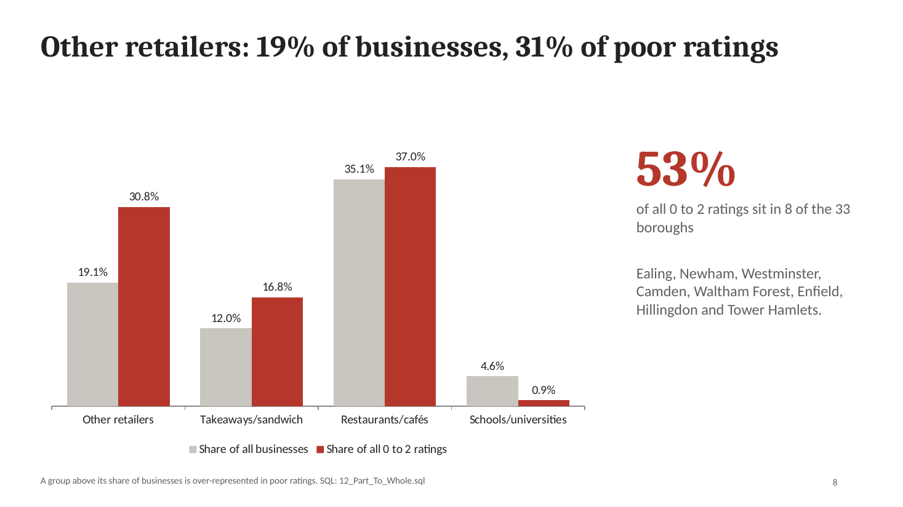
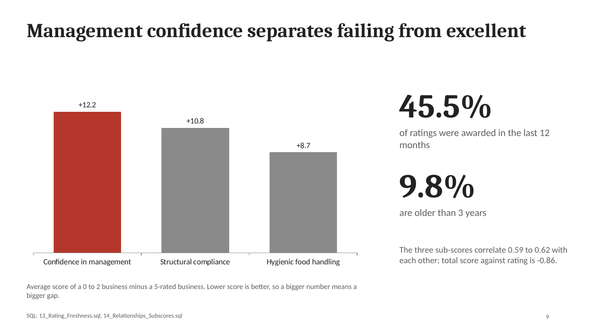

## 🌟 Introduction
Welcome to my repository **London Food Retail Insights**, where I took the Food Standards Agency (FSA) Food Hygiene Rating data for London through a full workflow: API extraction, data cleaning, a structured Exploratory Data Analysis (EDA) in SQL, and a final findings report.

Through this project I analyzed **79,726 food businesses across 33 London local authorities** to answer key questions such as: How good are London's food businesses overall? Which boroughs and business types perform best and worst? Where do the poor ratings concentrate? How fresh are the ratings?

You can view the full collection of SQL scripts used in this project in the [2_EDA_by_SQL](/2_EDA_by_SQL) folder.

## Background
The purpose of this project was to show a repeatable way to explore a new dataset: not a random set of queries, but a fixed sequence of questions that moves from "can I trust this data?" to "what should someone do with it?".

As a data analyst, I wanted to demonstrate how to:

- Extract data from a public API and clean it into an analysis-ready table.
- Audit data quality *before* analysing, so placeholders and unrated records don't distort results.
- Describe distributions, compare segments and test whether a gap is real or just a mix effect.
- Use advanced SQL (Window Functions, CTEs, `FILTER`, `PERCENTILE_CONT`, `CORR`) to turn the table into insights.

## 🗂️ Data Source
The data comes from the **FSA Food Hygiene Rating Scheme (FHRS) API**, saved as one JSON file of 79,727 records and loaded into PostgreSQL as the table `fsa_rating` (79,726 rows after removing one duplicate). One row is one food business with its latest hygiene rating.

| Column | Meaning |
| :--- | :--- |
| `fhrsid` | Unique business ID |
| `business_type` | 14 categories, e.g. Restaurant/Cafe/Canteen, Takeaway/sandwich shop |
| `local_authority_name` | The London borough (33 authorities, including the City of London) |
| `rating_value` | Text: `0` to `5`, or `Exempt` / `AwaitingInspection` / `AwaitingPublication` |
| `rating_date` | Date of the last inspection |
| `scores_hygiene`, `scores_structural`, `scores_confidence_in_management` | The three inspection sub-scores. **Lower is better** |
| `overall_score` | Mean of the three sub-scores (added during cleaning) |
| `geocode_latitude`, `geocode_longitude` | Business location |

# 🛠️ Tools I Used
- **🐍 Python (pandas, SQLAlchemy)** : API extraction, JSON flattening, cleaning and loading the table into PostgreSQL, inside Jupyter notebooks.

- **🛢️ SQL (Structured Query Language)** : The core of the analysis. I used it to audit, aggregate, window, compare and rank the data.

- **🐘 PostgreSQL** : The database engine, chosen for its analytical functions (`PERCENTILE_CONT`, `FILTER`, `CORR`, `DATE_TRUNC`, window functions).

- **💻 Visual Studio Code (VS Code)** : My environment for writing and organizing the notebooks and SQL scripts.

- **📊 Power BI** : Planned next step, to build an interactive dashboard on the final SQL view.

## 🧹 General Cleaning Process
Before any analysis could begin, the raw API output required several steps (`1_Data_Cleaning.ipynb`):

1. **Flattening** : Normalized the nested JSON (`geocode` and `scores` objects) into flat columns with `pd.json_normalize()`.

2. **Duplicates** : Found and dropped 1 duplicated row.

3. **Dropping Unneeded Columns** : Removed 11 columns with no analytical value, such as `Phone`, `Distance` (completely empty), `RatingKey`, email and website fields.

4. **Standardization** : Converted all headers to `snake_case` with a regex function, and turned empty strings into proper nulls.

5. **Handling Missing Values** : Filled missing address lines and post codes with `'Unknown'`. Sub-scores were deliberately left as `NULL`, because filling them would invent inspection results.

6. **Data Types** : Converted `rating_date` to a date and the geocodes to numbers.

7. **Feature Creation** : Added `overall_score` as the mean of the three sub-scores, then loaded the table into PostgreSQL.

**A second cleaning layer, in SQL.** The audit (below) showed that cleaning alone was not enough: 12.4% of businesses have no numeric rating. So I built a view, `fsa_rated`, that keeps only real 0 to 5 ratings. Every later query reads from this one view, so all numbers follow the same rules.

## 🧭 The EDA Framework
This is the part I wanted to make reusable. Each step answers one question, and each SQL file belongs to one step.

| Step | Question to answer | SQL files |
| :--- | :--- | :--- |
| **1. Frame** | What is one row? Which business questions am I answering? | This README |
| **2. Structure** | What columns, types and categories do I have? | `1_Dimensions`, `2_Date`, `3_Measures` |
| **3. Quality** | Can I trust it? Duplicates, blanks, placeholders, impossible values? | `8_Data_Quality_Audit` |
| **4. Distribution** | What does each variable look like on its own? | `10_Distribution_Analysis` |
| **5. Segments** | Which groups differ, by how much, and is each group big enough to trust? | `4_Magnitude`, `5_Rank`, `11_Segment_Performance` |
| **6. Time** | How has it changed, and how fresh is it? | `6_Change_Over_Time`, `7_Cumulative`, `13_Rating_Freshness` |
| **7. Insights** | What moves together, and what is the "so what"? | `12_Part_To_Whole`, `14_Relationships`, `15_Insights_Summary` |

## 📈 Key SQL Features & The Analysis
This project consists of several SQL modules that explore the data from different angles.

1. **Data Quality Audit**

    I started by checking whether the data could be trusted. A single `UNION ALL` scorecard shows every problem at once.

```sql
-- One-glance quality scorecard
SELECT 'total_businesses' AS check_name, COUNT(*)::TEXT AS result FROM fsa_rating
UNION ALL
SELECT 'rated_0_to_5', COUNT(*)::TEXT FROM fsa_rating WHERE rating_value ~ '^[0-5]$'
UNION ALL
SELECT 'not_rated (exempt/awaiting)', COUNT(*)::TEXT FROM fsa_rating WHERE rating_value !~ '^[0-5]$'
UNION ALL
SELECT 'placeholder_dates', COUNT(*)::TEXT FROM fsa_rating WHERE rating_date < DATE '1990-01-01'
UNION ALL
SELECT 'rated_but_missing_scores', COUNT(*)::TEXT FROM fsa_rating
WHERE rating_value ~ '^[0-5]$' AND scores_hygiene IS NULL;
```
| Check | Result |
| :--- | :--- |
| Total businesses | 79,726 |
| Rated 0 to 5 | 69,839 |
| Not rated (Exempt / Awaiting) | 9,887 |
| Placeholder dates (1900 / 1901) | 9,887 |
| Rated but missing all sub-scores | 801 |

    The unrated businesses and the 1901 dates turned out to be the *same* 9,887 rows. One view fixes both problems.



    **What it means:** about 1 in 8 records is not a rating at all. These are businesses waiting for their first inspection, exempt from the scheme, or waiting for a result to be published, and the system stores a fake 1901 date for them. If I had analysed the raw table, two things would have gone wrong. Every percentage would be pulled down (the five-star share would read 59.9% instead of 68.3%), and every query by year would have shown a made-up 1901. The 801 rated businesses with no sub-scores are a smaller gap. I kept their rating and left their total score blank rather than guessing it.

2. **Distributions**

    I used a window function to see how skewed the ratings are.

```sql
-- Rating distribution with cumulative share from the top rating
SELECT rating_num,
    COUNT(*) AS businesses,
    ROUND(COUNT(*) * 100.0 / SUM(COUNT(*)) OVER (), 1) AS pct,
    ROUND(SUM(COUNT(*)) OVER (ORDER BY rating_num DESC) * 100.0
          / SUM(COUNT(*)) OVER (), 1) AS cumulative_pct_from_top
FROM fsa_rated
GROUP BY rating_num
ORDER BY rating_num DESC;
```
| Rating | Businesses | % | Cumulative % |
| :--- | :--- | :--- | :--- |
| 5 | 47,725 | 68.3 | 68.3 |
| 4 | 12,325 | 17.6 | 86.0 |
| 3 | 5,932 | 8.5 | 94.5 |
| 2 | 1,949 | 2.8 | 97.3 |
| 1 | 1,625 | 2.3 | 99.6 |
| 0 | 283 | 0.4 | 100.0 |

    The distribution is heavily skewed to the top, so an average would hide the tail. The metric that matters is the **share rated 0 to 2: 5.5% (3,857 businesses)**.



    **What it means:** London's food businesses are, on the whole, doing well. More than two thirds hold the top rating and 86% hold a 4 or 5. But a tall bar at 5 hides a thin tail, and that tail is where the risk is. The typical business scores 10 on the combined inspection score (lower is better), yet the worst 1% score around 50 or more. The tail is not small in absolute terms: 5.5% of roughly 70,000 businesses is 3,857 premises, and 283 of them hold the lowest rating of 0. That is why I track the share rated 0 to 2 rather than the average rating.

3. **Segmentation Against a Benchmark**

    I compared every borough with the London average, ignoring groups under 30 businesses, and ranked them with `RANK()`.

```sql
SELECT local_authority_name,
    COUNT(*) AS rated_n,
    ROUND(AVG(is_five_star::INT) * 100, 1) AS pct_five_star,
    ROUND(AVG(is_low_rated::INT) * 100, 1) AS pct_low_rated,
    ROUND(AVG(is_five_star::INT) * 100
        - (SELECT AVG(is_five_star::INT) * 100 FROM fsa_rated), 1) AS pts_vs_london,
    RANK() OVER (ORDER BY AVG(is_five_star::INT) DESC) AS rank_best_to_worst
FROM fsa_rated
GROUP BY local_authority_name
HAVING COUNT(*) >= 30
ORDER BY pct_five_star DESC;
```
| Borough | Rated | % Five-star | % Rated 0-2 | vs London (pts) |
| :--- | :--- | :--- | :--- | :--- |
| City of London Corporation | 1,685 | 87.8 | 2.7 | +19.4 |
| Kensington and Chelsea | 1,833 | 87.7 | 0.9 | +19.4 |
| Merton | 1,268 | 81.4 | 1.7 | +13.1 |
| ... | | | | |
| Ealing | 3,048 | 58.0 | 12.4 | -10.3 |
| Waltham Forest | 1,825 | 52.0 | 11.7 | -16.3 |
| Newham | 2,432 | 49.1 | 14.2 | -19.3 |

    That is a **39-point gap** between the best and worst borough. By business type, schools and universities lead (88.9% five-star) while "Retailers - other" (56.8%) and takeaways (57.0%) trail.





    **What it means:** two businesses with the same standards can face very different odds of a top rating depending on where they are and what they sell. In the City of London and Kensington and Chelsea close to 9 in 10 businesses hold a 5. In Newham it is fewer than 1 in 2, and Newham also has the highest share rated 0 to 2 (14.2%). By type, institutions that run to fixed procedures (schools, universities, care settings) and supermarkets do best, while takeaways and smaller shops trail. Restaurants and cafés sit just under the London average. I have not tested *why* these differences exist. Inspection practice, how quickly businesses change hands and local deprivation are all plausible, which is why joining deprivation data is my first next step.

4. **Is the Gap Real, or Just Business Mix?**

    A borough full of takeaways would score lower for a boring reason. I used a CTE to work out what each borough *should* score given its mix of business types, then compared it with what it actually scores.

```sql
WITH type_avg AS (
    SELECT business_type, AVG(rating_num) AS expected_rating
    FROM fsa_rated
    GROUP BY business_type
)
SELECT r.local_authority_name,
    ROUND(AVG(r.rating_num), 2) AS actual_avg,
    ROUND(AVG(t.expected_rating)::NUMERIC, 2) AS expected_avg_given_mix,
    ROUND((AVG(r.rating_num) - AVG(t.expected_rating))::NUMERIC, 3) AS gap_vs_expected
FROM fsa_rated r
JOIN type_avg t USING (business_type)
GROUP BY r.local_authority_name
HAVING COUNT(*) >= 30
ORDER BY gap_vs_expected;
```
| Borough | Actual | Expected for its mix | Gap |
| :--- | :--- | :--- | :--- |
| Newham | 3.94 | 4.43 | -0.499 |
| Waltham Forest | 4.01 | 4.41 | -0.402 |
| Ealing | 4.18 | 4.49 | -0.311 |
| ... | | | |
| Kensington and Chelsea | 4.83 | 4.46 | +0.372 |

    Newham, Waltham Forest and Ealing stay at the bottom even after allowing for their business mix, so the gap is not just a mix effect.



    **What it means:** the obvious objection to the borough ranking is that some boroughs simply have more takeaways and small shops, which score lower everywhere. This chart tests that. "Expected" is the rating a borough would have if each of its businesses scored the London average for its type. Newham should average about 4.43 given what it sells, but actually averages 3.94, roughly half a rating point lower. Waltham Forest and Ealing show the same pattern. At the other end, Kensington and Chelsea, the City of London and Merton beat their expectation. So the gap is not explained by what the businesses sell. Something else about these places is associated with lower ratings, and this analysis cannot say what.

5. **Part-to-Whole & Pareto Analysis**

    To see where poor ratings come from, I compared each group's share of *all businesses* with its share of *all 0 to 2 ratings*, and built a running total across boroughs.

```sql
SELECT business_type,
    ROUND(COUNT(*) * 100.0 / SUM(COUNT(*)) OVER (), 1) AS pct_of_all_businesses,
    ROUND(COUNT(*) FILTER (WHERE is_low_rated) * 100.0
          / SUM(COUNT(*) FILTER (WHERE is_low_rated)) OVER (), 1) AS pct_of_all_low_rated
FROM fsa_rated
GROUP BY business_type
ORDER BY pct_of_all_low_rated DESC;
```
| Business type | % of all businesses | % of all 0-2 ratings |
| :--- | :--- | :--- |
| Restaurant/Cafe/Canteen | 35.1 | 37.0 |
| Retailers - other | 19.1 | **30.8** |
| Takeaway/sandwich shop | 12.0 | 16.8 |
| School/college/university | 4.6 | 0.9 |

    "Retailers - other" make up 19.1% of businesses but 30.8% of poor ratings. A running-total query also shows that **8 of the 33 boroughs hold 53% of all 0 to 2 ratings**: Ealing, Newham, Westminster, Camden, Waltham Forest, Enfield, Hillingdon and Tower Hamlets.



    **What it means:** this view separates "big" from "over-represented". Restaurants and cafés have the most poor ratings (1,426) mainly because they are the biggest group, and their share of poor ratings (37.0%) is close to their share of businesses (35.1%). Other retailers and takeaways are different: each has a clearly larger share of the poor ratings than of the businesses, so they are the groups where a poor rating is most likely. Schools are the opposite, with 4.6% of businesses but only 0.9% of poor ratings. Geographically the problem is concentrated too, with 8 of 33 boroughs holding over half of all poor ratings. For anyone with limited inspection time, that points at other retailers and takeaways in those boroughs.

6. **Rating Freshness**

    I measured how old each current rating is, relative to the newest inspection in the data.

```sql
WITH ref AS (SELECT MAX(rating_date) AS ref_date FROM fsa_rated)
SELECT CASE
        WHEN rating_date >= ref_date - INTERVAL '12 months' THEN '1. under 1 year'
        WHEN rating_date >= ref_date - INTERVAL '24 months' THEN '2. 1-2 years'
        WHEN rating_date >= ref_date - INTERVAL '36 months' THEN '3. 2-3 years'
        WHEN rating_date >= ref_date - INTERVAL '60 months' THEN '4. 3-5 years'
        ELSE '5. 5+ years'
    END AS rating_age,
    COUNT(*) AS businesses,
    ROUND(COUNT(*) * 100.0 / SUM(COUNT(*)) OVER (), 1) AS pct
FROM fsa_rated, ref
GROUP BY 1
ORDER BY 1;
```
| Rating age | Businesses | % |
| :--- | :--- | :--- |
| Under 1 year | 31,799 | 45.5 |
| 1-2 years | 22,514 | 32.2 |
| 2-3 years | 8,653 | 12.4 |
| 3-5 years | 4,275 | 6.1 |
| 5+ years | 2,598 | 3.7 |

    Ratings are fairly fresh. But businesses inspected in 2025 and 2026 look worse (6 to 9% rated 0-2 against about 1% in 2022-23). That is most likely a **selection effect**: poor performers are re-inspected sooner, so older ratings are the survivors. It is not proof that standards fell.

    **What it means:** 45.5% of current ratings were awarded in the last 12 months and only 3.7% are more than five years old, so the snapshot is reasonably current. The tempting conclusion from the by-year table is that standards have dropped, because recent inspections look much worse. I do not think that is right. Businesses that score badly are revisited sooner, so they move into the recent years, while businesses with a good rating are left alone and stay in the older years. The older years therefore look good by construction. With one rating per business I cannot separate that effect from a real change, so I report it as a limit rather than a finding.

7. **Relationships Between Scores**

    Finally, I used `CORR()` and conditional averages with `FILTER` to see which sub-score separates failing businesses from excellent ones.

```sql
-- How many points worse (higher) is a 0-2 business than a 5-rated one?
SELECT
    ROUND(AVG(scores_hygiene) FILTER (WHERE is_low_rated)::NUMERIC
        - AVG(scores_hygiene) FILTER (WHERE is_five_star)::NUMERIC, 1) AS hygiene_gap,
    ROUND(AVG(scores_structural) FILTER (WHERE is_low_rated)::NUMERIC
        - AVG(scores_structural) FILTER (WHERE is_five_star)::NUMERIC, 1) AS structural_gap,
    ROUND(AVG(scores_confidence_in_management) FILTER (WHERE is_low_rated)::NUMERIC
        - AVG(scores_confidence_in_management) FILTER (WHERE is_five_star)::NUMERIC, 1) AS mgmt_gap
FROM fsa_rated;
```
| Hygiene gap | Structural gap | Management confidence gap |
| :--- | :--- | :--- |
| 8.7 | 10.8 | **12.2** |

    The three sub-scores correlate 0.59 to 0.62 with each other, and total score against rating is -0.86. **Management confidence is the sub-score that most separates failing from excellent businesses.**



    **What it means:** a business rated 0 to 2 scores on average 12.2 points worse on confidence in management than a 5-rated business, against 10.8 on structure and 8.7 on hygiene (lower is better). That sub-score reflects how well the business manages food safety, through systems, records and training, rather than what the kitchen looks like on the day. The three scores move together (correlations of 0.59 to 0.62), so a business that is weak on one is usually weak on the others. The -0.86 against the final rating is expected, since the rating is built from these scores, so I use it as a sanity check, not a discovery.

## 📑 The Final Reports
The project ends with a reporting layer built on the clean view.

#### 🛠️ SQL Analytical Layer (The Engine)
- [9_Analysis_View.sql](/2_EDA_by_SQL/9_Analysis_View.sql) : Creates `fsa_rated`, the single clean source for all analysis. It keeps only real 0-5 ratings and adds `rating_num`, `total_score`, `is_five_star` and `is_low_rated`.

- [15_Insights_Summary.sql](/2_EDA_by_SQL/15_Insights_Summary.sql) : One headline table that feeds the slide deck: best and worst borough, best and worst business type, share rated 5, share rated 0-2 and rating age.

#### 🎨 Presentation Layer (The Interface)
- **📽️ Slide deck** : A 10-slide summary of the findings, built from the query results above.

- **📊 Power BI dashboard (planned)** : It will consume `fsa_rated` for a borough ranking, a business-type view and rating freshness.

## 💡 What I Learned
Analyzing this dataset gave me several meaningful lessons:

1. **Audit Before You Analyse** : Without checking quality first, the 9,887 unrated businesses and their fake 1901 dates would have silently distorted every percentage (five-star would read 59.9% instead of 68.3%) and every year chart.

2. **Use a Benchmark and Show Group Size** : A percentage means nothing without the London average beside it and the number of businesses behind it. Filtering groups under 30 stopped tiny boroughs and types from topping the rankings by luck.

3. **Test the Obvious Explanation** : The "borough gap is just business mix" idea sounded right, and testing it with a CTE showed it was wrong for the worst boroughs.

4. **Window Functions Are Invaluable** : `OVER()`, `RANK()` and running totals gave me percent-of-total, rankings and Pareto curves without slow self-joins.

5. **Describe, Don't Over-Claim** : The recent-years result looks like a decline but is probably a selection effect. Naming that limit matters as much as the finding.

## ✅ Conclusion
This project was more than a series of SQL queries. It was a way to turn a raw public API feed into a clear picture of food hygiene across London, using a repeatable seven-step framework that I can apply to any new dataset.

### 🌟 Key Takeaways:
* **Most businesses are doing well:** 68.3% are rated 5 and 86.0% are rated 4 or 5.
* **The risk is concentrated:** 5.5% are rated 0-2, mostly in "Retailers - other", takeaways and restaurants, and in a handful of boroughs led by Ealing and Newham.
* **Location matters beyond business mix:** Newham, Waltham Forest and Ealing sit well below expectation.
* **Management is the weak point:** Confidence in management separates failing businesses from excellent ones more than hygiene or structure does.

## 🗂️ Repository Structure & How to Reproduce
```
London Food Retail Insights/
├── 0_Data/
│   ├── 1_Data_Extraction_by_API.ipynb
│   ├── 2_fsa_london.json
│   └── 0_api-guidance.pdf
├── 1_Data_Cleaning/
│   └── 1_Data_Cleaning.ipynb        # cleans and loads `fsa_rating` into PostgreSQL
├── Images/                          # charts used in this README (taken from the slide deck)
├── London_Food_Retail_Insights.pptx # 10-slide findings deck
└── 2_EDA_by_SQL/
    ├── 1_Dimensions_Exploration.sql
    ├── 2_Date_Exploration.sql
    ├── 3_Measures_Exploration.sql
    ├── 4_Magnitude_Analysis.sql
    ├── 5_Rank_Analysis.sql
    ├── 6_Change_Over_Time.sql
    ├── 7_Cumulative_Analysis.sql
    ├── 8_Data_Quality_Audit.sql
    ├── 9_Analysis_View.sql
    ├── 10_Distribution_Analysis.sql
    ├── 11_Segment_Performance.sql
    ├── 12_Part_To_Whole.sql
    ├── 13_Rating_Freshness.sql
    ├── 14_Relationships_Subscores.sql
    └── 15_Insights_Summary.sql
```
1. Run `1_Data_Extraction_by_API.ipynb` (or use the saved JSON).
2. Run `1_Data_Cleaning.ipynb` to create the `fsa_rating` table in the PostgreSQL database `food_db`. Keep database credentials in an environment variable, not in the notebook.
3. Run the SQL files in `2_EDA_by_SQL` in order from `8` to `15`. File `9` creates the `fsa_rated` view that files `10` to `15` depend on.

## ⚠️ Data Notes & Limitations
- 9,887 businesses (12.4%) have no numeric rating and are excluded from rating analysis.
- 801 rated businesses have no sub-scores, so their `total_score` is `NULL`.
- 13,622 rows (17.1%) have no coordinates, and 23 fall outside Greater London.
- The newest rating date is 2026-07-16, so July 2026 is a partial month.
- Each business has only its latest rating, so the data cannot show how one business changed over time.

---
**Thank you for exploring my London Food Retail Insights project!**
